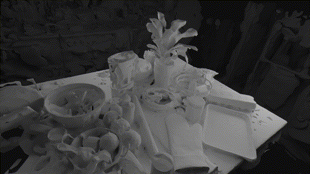
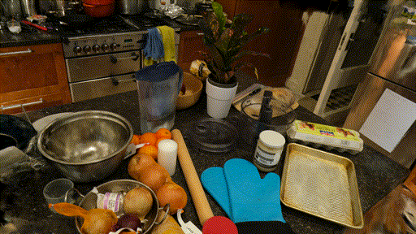
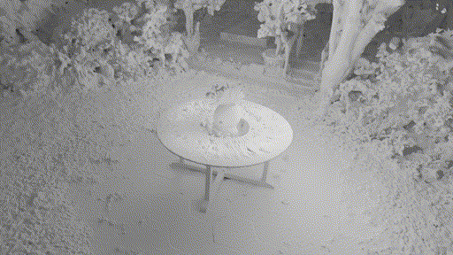
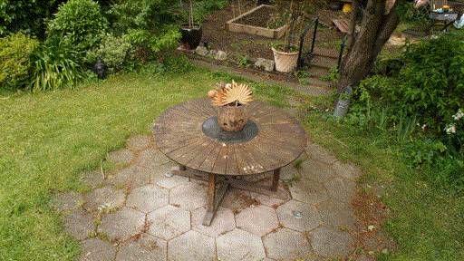
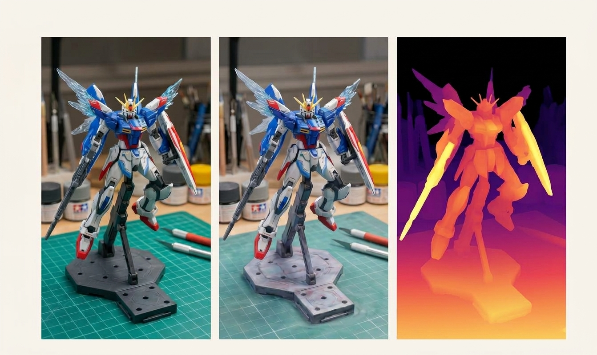
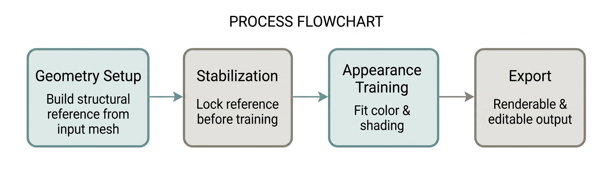

<div align="center">

# Xra-Net

### Freeze the shape. Keep learning the light.

<font size="4">
面向可靠重建几何与下游应用的网格引导三维高斯溅射方法
</font>
<br><br>

| <a href="#">arXiv (coming soon)</a> | <a href="#">Thesis</a> | Built on <a href="https://github.com/graphdeco-inria/gaussian-splatting">3D Gaussian Splatting</a> |

 
<br>
 

</div>

## Overview

Reconstructed 3D scenes are increasingly used as building blocks for robotics and simulation — training data, interaction assets, scene layouts — where geometry that can be trusted and reused matters more than raw visual fidelity alone.

Standard 3D Gaussian Splatting optimizes geometry and appearance together under one photometric objective, which can make the reconstructed shape only as reliable as whatever the training images happen to support. For downstream uses that depend on a trustworthy mesh — editing, simulation, asset reuse — that's often not reliable enough on its own.

This project aims for reconstructions whose geometry stays trustworthy enough for that kind of downstream use, without sacrificing too much visual fidelity along the way. Gaussians are anchored to an input mesh so the resulting geometry is easier to trust and reuse, while appearance keeps enough flexibility to stay visually competitive with standard Gaussian Splatting. Early results suggest this trade-off is workable across a range of scene types, though the exact balance shifts depending on how clean the input geometry is to begin with.

## Results at a glance

Rendering quality tracks reasonably close to standard 3D Gaussian Splatting across most scenes, with a modest edge on simpler, well-captured scenes and a modest give-back on more complex real-world captures — a trade made in exchange for noticeably steadier surface geometry.

<div align="center">

| | Simple / synthetic scenes | Complex real-world scenes |
|---|---|---|
| PSNR vs. 3DGS | ~+0.75 dB | ~−0.6 to −1.8 dB |
| Surface-fit metrics vs. 3DGS | ~2.0× / 3.2× | ~5.0× to 8.1× |

</div>

Full numbers, additional ablations, and where this trade-off stops being worth it are all in the thesis — this table is just the shape of the result, not a substitute for it.

<div align="center">

<br>
<b>Hybrid representation - Textured mesh - Depth map of the mesh</b>
</div>

## Pipeline

<div align="center">

</div>

```
1  Geometry setup      build a structural reference from the input scan or mesh
2  Stabilization       lock in that reference before any appearance training starts
3  Appearance training  fit color and shading against the fixed reference
4  Export              produce renderable and downstream-editable outputs
```

Appearance training is the only stage that keeps updating once the pipeline is past step 2.

## Installation & usage

```shell
python run_pipeline.py --scene <path_to_scene> --init-from 3dgs \
    --geometry-mode stable --appearance-mode adaptive
```

Qualitative comparison figures (GT / 3DGS / Ours) are produced with a separate rendering script — run with `--help` for the full argument list.

## Status

Research / prototype stage. A few features are implemented at a basic level but haven't been benchmarked on their own yet — treat this as a work in progress rather than a finished tool. Code release planned following publication; this repository currently documents the approach and preliminary results.

## Roadmap

- [ ] Expand evaluation to a broader range of scene types
- [ ] Explore simulation-ready asset export for downstream robotics use
- [ ] Benchmark the remaining prototype features mentioned above

## Acknowledgments

Built on top of the original [3D Gaussian Splatting](https://github.com/graphdeco-inria/gaussian-splatting) codebase. Please cite it alongside this work if you use this code.

## BibTeX

```
@mastersthesis{xranet2026,
  title={Xra-Net: Mesh-Guided 3D Gaussian Splatting for Downstream-Ready Scene Geometry},
  author={Anonymous},
  year={2026}
}
```
